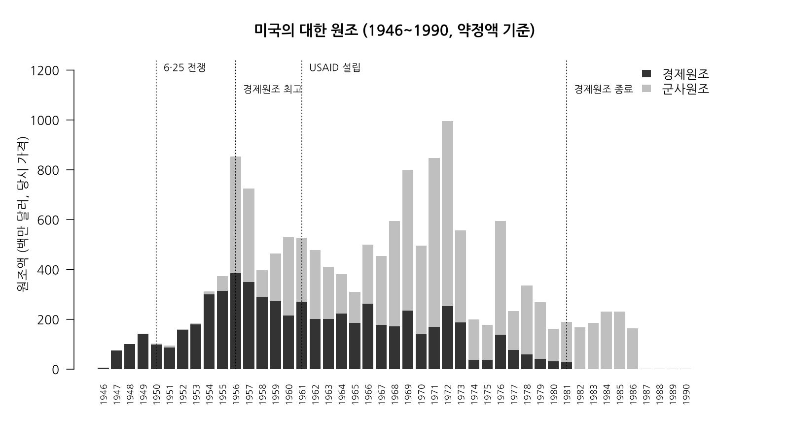
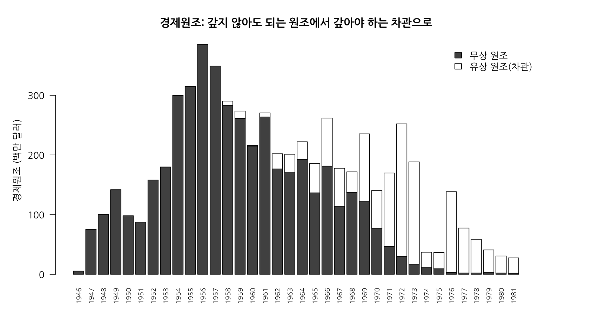
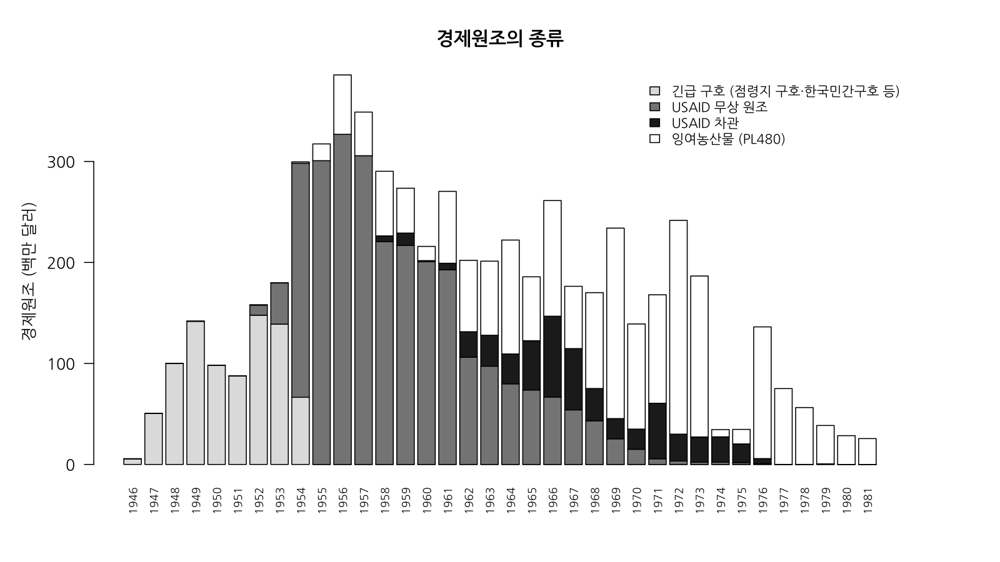
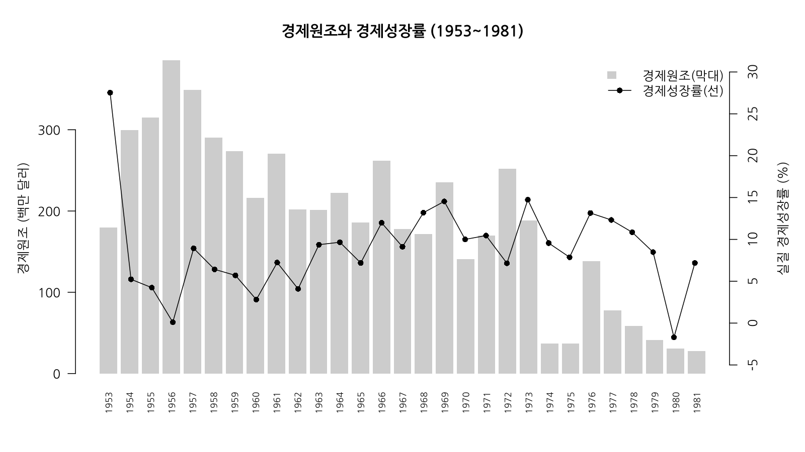
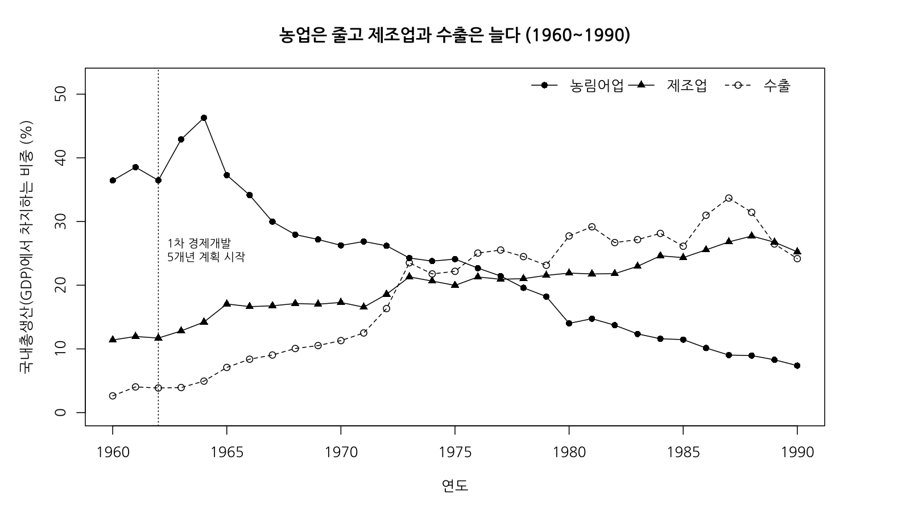

# 후속 탐구: 숫자로 다시 보는 원조 경제 (1946~1990)

> 탐구 질문: **미국 원조가 줄어든 뒤 우리 경제는 어떻게 변했을까?**
> 미국의 대한(對韓) 원조가 **시작된 1946년부터 끝난 1980년대까지**의 자료를 모아 연도별로 정리하고, R로 그래프를 그려 보았다.

## 폴더 구성

| 파일 | 내용 |
|---|---|
| `data/us_aid_korea_1946_2025.csv` | 미국의 대한 원조, 연도별 (경제·군사, 무상·유상, 종류별) |
| `data/korea_economy_1946_2000.csv` | 우리나라 경제 지표, 연도별 (성장률, 1인당 GDP, 산업 비중, 수출) |
| `data/aid_and_economy_1946_1990.csv` | 위 두 자료를 연도로 합친 분석용 자료 |
| `data/raw/` | 내려받은 원자료 (원조 원자료 중 한국 부분, 매디슨 자료, 세계은행 자료) |
| `analysis.R` | 그래프 5개와 시기별 평균·상관계수를 만드는 R 코드 (패키지 설치 필요 없음) |
| `charts/` | R로 그린 그래프 |
| `결과_요약.txt`, `결과_시기별평균.csv` | R로 계산한 결과 |

R에서 이 폴더를 작업 폴더로 정하고 `source("analysis.R")`를 실행하면 그래프와 결과가 다시 만들어진다.

---

## 1. 원조의 시작부터 끝까지 (연표)

| 시기 | 일어난 일 | 자료에서 보이는 변화 |
|---|---|---|
| 1945~1948 | 미군정, **점령지역 구호 원조(GARIOA)** 시작 | 1946년 560만 달러로 시작해 1949년 1억 4,180만 달러까지 늘어남 |
| 1948.12 | 대한민국과 미국 사이에 원조 협정 체결 | |
| 1950~1953 | 6·25 전쟁, **한국민간구호(CRIK)** 같은 긴급 구호 | 1946~1953년 긴급 구호가 경제원조의 대부분 (합계 약 7억 7천만 달러) |
| 1954~ | 휴전 뒤 **경제 부흥 원조** 본격화 (오늘날 USAID의 전신 기관들이 담당) | 1954년 경제원조 약 3억 달러로 크게 늘어남 |
| 1955 | 한미 **잉여농산물 원조 협정(PL480)** | 1955년부터 잉여농산물 원조가 들어오기 시작 |
| **1956** | **경제원조 최고** (미국 약정액 기준) | 경제원조 **3억 8,550만 달러**, 군사원조까지 합하면 8억 5,300만 달러 |
| 1958 | **첫 경제 차관**(갚아야 하는 원조) | 이때부터 차관이 조금씩 생김 |
| 1961 | 미국 대외원조법, **USAID(국제개발처) 설립** | |
| 1962 | 제1차 경제개발 5개년 계획 시작 | 무상 원조는 줄고 차관과 잉여농산물이 늘어남 |
| 1971~1973 | 군사원조 최고 (1972년 7억 4,330만 달러) | 경제원조의 대부분이 차관으로 바뀜 |
| **1981** | **경제원조 사실상 끝** | 1981년 2,760만 달러를 마지막으로 1982년부터 0 |
| 1986 | 군사원조(차관 포함) 사실상 끝 | 1987년부터 거의 0 |
| 1991, 2010 | 한국국제협력단(KOICA) 설립, OECD 개발원조위원회(DAC) 가입 | 원조를 **받던 나라에서 주는 나라로** |

---

## 2. 자료로 알게 된 것

**① 원조는 1946년에 시작해 1981년(경제원조), 1986년(군사원조)에 끝났다.**
1946~1981년 경제원조는 모두 **약 61억 달러**(당시 가격), 1946~1986년 군사원조는 **약 89억 달러**였다. 지금 돈의 가치(2025년 기준)로 바꾸면 경제원조만 약 490억 달러에 이른다.

**② 갚지 않아도 되는 원조에서 갚아야 하는 차관으로 바뀌었다.**
경제원조 가운데 차관이 차지하는 비중은 1946~1960년 **0.7%**, 1961~1970년 **24.1%**, 1971~1981년 **87.6%**였다. 기사에서 쓴 "원조가 줄면서 무상 원조가 차관으로 바뀌었다"는 내용을 숫자로 확인할 수 있다.

**③ 원조의 종류도 시기마다 달랐다.**
1953년까지는 긴급 구호, 1954~1961년에는 USAID의 무상 원조(삼백산업의 원료인 원면·원당·원맥 등이 여기에 들어온다), 1960년대 후반부터는 잉여농산물(PL480)과 차관이 중심이 되었다.

**④ 원조가 줄어든 시기에 오히려 성장률은 높아졌다.**

| 시기 | 경제원조 평균 | 군사원조 평균 | 차관 평균 | 경제성장률 평균 |
|---|---|---|---|---|
| 1946~53 해방·전쟁기 | 1억 580만 달러 | 210만 달러 | 0 | 7.3% |
| 1954~57 원조 최고기 | 3억 3,720만 달러 | 2억 2,840만 달러 | 0 | 4.6% |
| 1958~61 원조 감소기 | 2억 6,250만 달러 | 2억 1,690만 달러 | 680만 달러 | 5.5% |
| 1962~71 경제개발 계획기 | 1억 9,690만 달러 | 3억 3,010만 달러 | 6,140만 달러 | 10.0% |
| 1972~81 차관 중심기 | 8,880만 달러 | 2억 8,220만 달러 | 8,040만 달러 | 9.0% |
| 1982~90 원조 이후 | 0 | 1억 990만 달러 | 0 | 10.2% |

경제원조액과 경제성장률의 상관계수는 1954~1961년 **-0.15**, 1954~1981년 **-0.19**로 0에 가깝다. 원조를 많이 받은 해에 성장률이 높았다고 보기는 어렵다는 뜻이다. 1946~53년 평균이 높게 나온 것은 휴전 직후인 1953년의 큰 반등(27.5%) 때문이다.

**⑤ 원조가 끝나 가는 동안 산업의 모습이 바뀌었다.**
국내총생산에서 차지하는 비중이 1960년에는 농림어업 36.4%, 제조업 11.4%, 수출 2.6%였는데, 1990년에는 농림어업 7.4%, 제조업 25.2%, 수출 24.2%가 되었다. 원조에 기대던 소비재 공업 중심의 경제가 수출과 제조업 중심으로 바뀐 것을 볼 수 있다.

---

## 3. 해석할 때 조심할 점

- **원인과 결과는 아직 모른다.** 성장률이 높아진 데에는 경제 개발 계획, 수출 정책, 4·19 혁명·5·16 군사 정변 같은 정치 변화, 한일 국교 정상화(1965) 뒤 들어온 자금 등 여러 까닭이 함께 있을 수 있다.
- **약정액과 도입액은 다르다.** 이 자료는 미국 정부가 "주기로 정한 돈"(약정액, 미국 회계연도 기준)이다. 우리나라 통계는 실제로 "들어온 돈"(도입액)을 세어서, 원조가 가장 많았던 해를 1957년으로 적은 자료가 많다. 기사에서 "지난해(1957년)를 고비로"라고 쓴 것과 1년 차이가 나는 것은 이 때문이다.
- **미국 원조만 담았다.** 국제연합한국재건단(UNKRA) 같은 다른 원조는 빠져 있어서, "1945~1961년 원조 약 31억 달러"처럼 우리나라 책에 나오는 숫자와 다를 수 있다.
- **경제성장률은 매디슨 자료로 계산했다.** 1970년 이전 국민소득 통계는 지금과 만드는 기준이 달라 그대로 이어 붙이면 안 된다(박창귀, 2012). 이번 분석은 한 가지 기준으로 정리된 매디슨 프로젝트 자료(한국 부분은 차명수·김낙년 등이 정리한 『Historical Statistics of Korea』, 2020)를 썼다. 한국은행 공식 성장률과는 해마다 조금씩 다르다.
- **금액은 당시 가격이다.** 1950년의 1달러와 1980년의 1달러는 가치가 다르므로, 시기를 비교할 때는 `econ_aid_2025usd`(2025년 가치로 바꾼 금액)도 함께 보는 것이 좋다.

## 4. 아직 못 모은 자료 (다음에 할 일)

이번 작업 환경에서는 한국은행 경제통계시스템(ECOS)과 국가통계포털(KOSIS)에 접속할 수 없어서, 아래 자료는 직접 내려받아 보충해야 한다.

- **1954~1959년 수출액과 산업별 비중**: 세계은행 자료는 1960년부터 있다. ECOS의 국민계정과 수출입 통계에서 1950년대 값을 찾아 `aid_and_economy_1946_1990.csv`에 열을 더하면 된다.
- **한국은행 공식 경제성장률**: ECOS에서 연간 실질 GDP 성장률을 내려받아 매디슨 자료와 비교해 보면 "통계 기준에 따라 숫자가 달라진다"는 점을 직접 보여 줄 수 있다.
- **QGIS 지도용 시도별 인구(1960·1966·1970년)**: KOSIS에서 '인구총조사'를 검색해 시도별 인구를 내려받고, 시도 경계 지도 파일(통계지리정보서비스 SGIS 등)에 연결하면 도시로의 인구 이동 지도를 만들 수 있다.

---

## 5. 자료 설명 (열 이름)

**us_aid_korea_1946_2025.csv** (단위: 백만 달러, 당시 가격, 미국 회계연도 약정액)

| 열 | 뜻 |
|---|---|
| `year` | 연도 (1976년에는 회계연도가 바뀌며 생긴 3개월(1976tq)을 더함) |
| `econ_aid`, `mil_aid`, `total_aid` | 경제원조, 군사원조, 합계 |
| `econ_grant`, `econ_loan` | 경제원조 중 무상 원조, 유상 원조(차관) |
| `relief` | 긴급 구호: 점령지역 구호(GARIOA), 유엔 구제부흥기구 후속 원조, 한국민간구호(CRIK) |
| `usaid_grant`, `usaid_loan` | USAID(와 전신 기관)의 무상 원조, 차관 |
| `pl480` | 잉여농산물 원조(PL480, 평화를 위한 식량) |
| `mil_grant`, `mil_loan` | 군사원조 중 무상, 유상(차관) |
| `econ_aid_2025usd`, `total_aid_2025usd` | 2025년 달러 가치로 바꾼 경제원조, 전체 원조 |

**korea_economy_1946_2000.csv**

| 열 | 뜻 | 출처 |
|---|---|---|
| `gdppc_2011usd` | 1인당 GDP (2011년 달러 기준) | 매디슨 프로젝트 2023 |
| `pop_thousand` | 인구 (천 명) | 매디슨 프로젝트 2023 |
| `gdp_growth_maddison` | 실질 경제성장률 (%), 1인당 GDP×인구로 계산 | 매디슨 프로젝트 2023 |
| `gdp_growth_wb` | 실질 경제성장률 (%), 1961년부터 | 세계은행 |
| `agri_share`, `manuf_share` | GDP에서 농림어업·제조업이 차지하는 비중 (%), 1960년부터 | 세계은행 |
| `export_share`, `export_usd_million` | GDP에서 수출이 차지하는 비중 (%), 수출액 (백만 달러), 1960년부터 | 세계은행 |

## 6. 출처

- 미국 대외원조 통계: U.S. Agency for International Development, *Foreign Aid Explorer* / *U.S. Overseas Loans and Grants (Greenbook)*, `us_foreign_aid_complete.csv` 중 대한민국 부분 (2026년 11월 내려받음)
- Maddison Project Database 2023, Groningen Growth and Development Centre (Bolt & van Zanden). 한국 1911~1990년 자료: Cha, M.S., Kim, N.N., Park, K.-J., Park, Y. (Eds.) (2020), *Historical Statistics of Korea*, Springer.
- World Bank, World Development Indicators (NY.GDP.MKTP.KD.ZG, NV.AGR.TOTL.ZS, NV.IND.MANF.ZS, NE.EXP.GNFS.ZS, NE.EXP.GNFS.CD)
- 박창귀 (2012), 「Korean National Income Based on a Chain Index: 1953~2010」, *KDI Journal of Economic Policy*
- 서울신문 「전후복구와 외원(새로 쓰는 한국 현대사 43)」(1995), 주간경향 「원조자금이 한국재벌 '기초 공사'」(2010) — 우리나라 통계 기준 원조 총액 비교용
